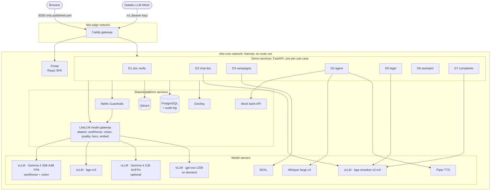

# NBE AI Demos on Dell AI infrastructure

> **Riyad Bank edition (branch `Riyadh-Bank`).** The same seven demos and platform as `main`, presented for **Riyad Bank (بنك الرياض)**: Riyad Bank logo and colours (`brand/`), IBM Plex Sans Arabic as the UI font, and the bank's name in the portal, the model prompts, the D1 loan documents and the D5 contracts (`.env.example`: `BANK_*`, `COMPOSE_PROJECT_NAME=ryd`, `IMAGE_TAG=ryd`). Start it with `make start-RYD`; `make start-NBE` switches back. Improvements made on `main` merge into this branch with `git merge main`; bank-specific files are `brand/`, `.env.example`, `locale.py`, `specs.py`, the gate prompts and `data/seed/`.
>
> **Localised for Saudi Arabia.** All synthetic content is Saudi: amounts in SAR, Saudi names, cities and national addresses, 10-digit national IDs, +966 mobiles, 15% VAT with a VAT number, mada cards, Nafath/Absher verification, SARIE transfers, SAMA rules (33.33% DBR, 5-year personal finance, the "SAMA Cares" complaints channel), a Sharia-compliant tawarruq contract template (profit rate and APR, takaful, no late-payment penalties, PDPL, Banking Disputes Committee), Saudi-dialect prompts and complaints, and Asia/Riyadh time. The locale lives in `packages/nbe_core/nbe_core/locale.py`, `data/generators/specs.py`, `brand/brand.json` (`locale`) and `eval/arabic_gate/prompts.yaml`; the seed data under `data/seed/` was re-authored from it. `PLAN.md` remains the original NBE programme plan; the platform sections of this README apply unchanged, while examples quoted below come from the NBE edition.

Seven live AI applications for the **National Bank of Egypt (NBE)**, one per NBE use case. They run fully offline and fully containerised: today on a single **Dell Pro Max with GB10** (the demo platform), and tomorrow on **Dell PowerEdge XE7745** or **XE9780** servers for production (see [Production rollout](#15-production-rollout-on-poweredge-xe7745-and-xe9780)).

| | |
|---|---|
| **Status** | All seven demos are built and pass the end-to-end UI walkthrough in Arabic and English. Measured results are in [section 11](#11-evaluation-and-measured-results). |
| **Open item** | Blind human scoring for the Arabic model gate at `/eval`, then `make models-lock`. |
| **Data** | 100% synthetic. No NBE or customer data is on the box. |
| **Positioning** | A single-user proof of concept on one GB10. Production sizing is done separately on PowerEdge. |
| **Guides** | [docs/runbook.md](docs/runbook.md) (operators) · [docs/talk-tracks.md](docs/talk-tracks.md) (presenters) · [docs/arabic_gate.md](docs/arabic_gate.md) (model scoring) · [PLAN.md](PLAN.md) (build plan, decisions, findings) |

---

## Contents

1. [The seven demos](#1-the-seven-demos)
2. [Quick start](#2-quick-start)
3. [Architecture](#3-architecture)
4. [Technology stack](#4-technology-stack)
5. [Models and memory on the GB10](#5-models-and-memory-on-the-gb10)
6. [Service reference](#6-service-reference)
7. [Demo designs](#7-demo-designs)
8. [Shared library: nbe_core](#8-shared-library-nbe_core)
9. [Synthetic data](#9-synthetic-data)
10. [Security, offline operation and governance](#10-security-offline-operation-and-governance)
11. [Evaluation and measured results](#11-evaluation-and-measured-results)
12. [Operations](#12-operations)
13. [Repository layout and configuration](#13-repository-layout-and-configuration)
14. [Design decisions and lessons learned](#14-design-decisions-and-lessons-learned)
15. [Production rollout on PowerEdge XE7745 and XE9780](#15-production-rollout-on-poweredge-xe7745-and-xe9780)
16. [Known limitations](#16-known-limitations)
17. [Brands: one platform, several banks](#17-brands-one-platform-several-banks)

---

## 1. The seven demos

| # | NBE use case | What it does | Key techniques |
|---|---|---|---|
| **D1** | Doc verification for credit lending | Reads a loan pack (ID, utility bill, HR letter, bank statement, commercial register, invoice), checks the documents against each other and for tampering, and returns an evidence-backed "flagged for review" verdict for a human to decide | Vision-LLM field extraction, image forensics (noise consistency, duplicate stamps, metadata, ELA heatmap), deterministic cross-document rules |
| **D2** | Chat with Document | Answers branch questions from working procedures with a citation on every sentence, prefers the current version, shows what changed since the previous one, and says "not found" instead of guessing | Retrieval with bge-m3, Qdrant and bge-reranker-v2-m3; grounded generation; version comparison |
| **D3** | Campaigns & Offers (hyper-personalisation) | Profiles a segment's interests from transactions, matches a partner merchant, writes Arabic/English/dialect copy, enforces compliance, renders a banner and sizes an A/B test | SQL analytics, semantic merchant search, structured generation, rule-based compliance with auto-fix, SDXL, power calculation |
| **D4** | AI Virtual Agent | Voice or chat agent: mock OTP, card block, balance, complaint ticket, human handoff; jailbreaks stopped live | Tool-calling agent loop, NeMo Guardrails (input and output), Whisper ASR, Piper TTS, mock core-banking API |
| **D5** | Legal Documents Summarisation | Summarises rulings and contracts, extracts clauses with verified quotes, flags risks and compares a contract with the approved template | Map-reduce summarisation, schema-guided extraction, quote verification, clause-level template diff |
| **D6** | NBE AI Assistant | One employee assistant for file chat, drafting, summaries, translation and code, with a router that picks the model per task and shows why; OpenAI-compatible endpoint for Dataiku | Task routing (rules plus LLM), documentation-grounded code answers, file conversion, OpenAI-compatible API |
| **D7** | Complaints Personalisation | Classifies complaints (topic, severity, sentiment, vulnerability), assigns SLAs and teams, drafts policy-checked replies that wait for human approval, mines trends | Zero-shot structured classification, SLA rules, similar-case retrieval, guarded drafting, embedding clustering |

The portal also hosts the **Arabic gate** (`/eval`): a blind scoring tool used to choose the models (section 11).

---

## 2. Quick start

Prerequisites: a GB10 (or any NVIDIA host with about 100 GB of free GPU memory) running Docker with the NVIDIA container runtime, `make`, and model weights in `/opt/models` (`make models` downloads them; this is the only step that needs the internet).

```bash
git clone https://github.com/tamereissa77/NBE-demo.git ~/NBE-demo && cd ~/NBE-demo
make up            # ~4 min cold: creates .env, frees the GPU, starts models one by one, loads demo data on first run
make verify        # portal, 7 demo APIs, offline proof, platform check of every model and service
make ui-test       # a real browser clicks through all seven demos (Playwright)
```

Open **http://localhost:8200** (or `http://<gb10-ip>:8200` on the LAN). Add `?lang=ar` for Arabic. Run `make` with no target to list every command.

---

## 3. Architecture

The system has four layers: a web portal, seven demo services, a shared platform of AI and data services, and model servers. Everything except the web gateway sits on an internal Docker network with no route to the internet.



**Request path (D2 example).** The browser posts a question to `/api/d2/ask`. The gateway strips the prefix and forwards it to the D2 service. D2 embeds the question (bge-m3 via LiteLLM), searches Qdrant for 24 candidates, reranks them (bge-reranker), builds a cited prompt from the top five, calls the `workhorse` alias, computes the version comparison, and returns the answer with a **trace**: every step, model and timing, shown in the portal's "Show the work" drawer.

**Design principles**

- **One demo, one service.** Each use case is an independent FastAPI container that can be built, scaled and replaced alone. They share code only through the `nbe_core` library.
- **Models are addressed by role, never by name.** Demos call `workhorse`, `vision`, `quality`, `hero` or `embed` through LiteLLM. Swapping a model is a one-line config change, and a missing on-demand model falls back to the workhorse automatically, with the fallback reported on screen.
- **Offline by construction.** Only the gateway is on a published network; every other container is on `nbe-core` (`internal: true`). Model servers run with `HF_HUB_OFFLINE=1`. `make offline-check` proves it.
- **Human decides.** Every consequential output (a loan verdict, a reply to a customer, a blocked card) is either a recommendation for a person or an action the customer confirmed; decisions are written to the audit log.
- **Show the work.** Every response carries its trace, so any number on screen can be explained live.

---

## 4. Technology stack

| Layer | Component | Version / image | Role and why it was chosen |
|---|---|---|---|
| Hardware (demo) | Dell Pro Max with GB10 | NVIDIA GB10 Grace Blackwell, 128 GB unified memory, 20-core Arm CPU, 273 GB/s | Compact, sovereign AI box for a portable proof of concept |
| OS | DGX OS | Ubuntu 24.04.4, NVIDIA driver 595.71 | NVIDIA's supported stack for GB10 |
| Containers | Docker Compose + NVIDIA container runtime | compose profiles per model group | Fully containerised, one control surface (`make`) |
| Model serving | vLLM | `nvcr.io/nvidia/vllm:26.05-py3` (vLLM 0.20, PyTorch 2.12 for sm_121) | One NVIDIA-built image serves LLMs, the VLM, embeddings and the reranker on aarch64 |
| Model gateway | LiteLLM proxy | 1.104 (`ghcr.io/berriai/litellm:main-stable`) | Role aliases, fallbacks, one OpenAI-compatible endpoint for every model |
| Workhorse LLM + vision | Gemma 4 26B-A4B-it | FP8 (online quantisation), 32k context | Best Arabic and tool-calling among fast models in the Arabic gate; reads document images natively |
| Quality LLM (optional) | Gemma 4 31B-IT | NVFP4, 16k context | Legal-quality summaries; provisionally dropped by the gate (too slow for the gain) |
| Hero LLM (on demand) | gpt-oss-120b | MXFP4, 16k context | Strongest reasoning and code explanation for D6 |
| Embeddings | BAAI bge-m3 | vLLM pooling runner, 1024 dims | Multilingual (Arabic and English) dense retrieval |
| Reranker | BAAI bge-reranker-v2-m3 | vLLM pooling runner | Cross-encoder precision for citations |
| Vector store | Qdrant | 1.16 | Collections per demo, payload filters (version, procedure) |
| Relational store | PostgreSQL | 16 | Demo state, D3 commerce data, D7 complaints, evaluation scores, audit log |
| Guardrails | NeMo Guardrails | 0.24.1 | Self-check input and output rails on the workhorse; banking policy prompts |
| Documents | Docling | 2.134 (CPU) | Layout-aware conversion of DOCX/HTML/PDF; page rendering for vision transcription |
| Speech to text | Whisper large-v3 | FP16, transformers on the NGC image | Arabic, Egyptian dialect and English |
| Text to speech | Piper | 1.8, voices ar_JO-kareem and en_US-lessac (CPU) | Light, offline, aarch64 wheels |
| Image generation | SDXL base 1.0 | diffusers 0.41, FP16 | Banner mock-ups for D3 |
| Forensics | OpenCV + Pillow + NumPy | opencv-python-headless 5.0 | Noise analysis, stamp matching, ELA |
| Demo services | FastAPI + httpx + psycopg | FastAPI 0.142, Python 3.12 | Async APIs, one container per demo |
| Portal | React + Vite + Tailwind CSS | React 19, Vite 6, Tailwind 4, TypeScript 5.7 | Bilingual (RTL) single-page app with the NBE theme; fonts bundled for offline use |
| Web gateway | Caddy | 2.11 | Single published port, path routing, caching headers |
| Testing | Playwright, pytest-style scripts | Playwright 1.55 | End-to-end UI walkthrough, backup video recording |

About 7,700 lines of application code (Python, TypeScript, shell) across 27 containers.

---

## 5. Models and memory on the GB10

The GB10 has 128 GB of unified CPU/GPU memory, about 100 GB usable for models. vLLM sizes its KV cache from the memory that is free when it starts, so model servers start strictly one after another (`scripts/up.sh`), each with an explicit `--gpu-memory-utilization`.

| Service | Model and serving | Memory (measured) | Speed (single user) |
|---|---|---|---|
| `nbe-llm` | Gemma 4 26B-A4B FP8, 32k context, util 0.30 | 35.4 GB (25.7 GB weights) | 30 to 40 tokens/s |
| `nbe-embed` | bge-m3 | 1.7 GB | 3 texts in 40 ms |
| `nbe-rerank` | bge-reranker-v2-m3 | 1.7 GB | 20 ms per query |
| `nbe-asr` | Whisper large-v3 FP16 | 3.4 to 4.9 GB | 1.2 s for 7.8 s of Arabic audio |
| `nbe-tts` | Piper (CPU) | none | ~0.3 s per sentence |
| `nbe-sdxl` | SDXL base FP16 (cuDNN off, section 14) | 7 to 16 GB | 11 s per 1216×832 banner |
| `nbe-llm-q` (optional) | Gemma 4 31B NVFP4, 16k context | 37.7 to 43 GB | 6.7 tokens/s |
| `nbe-hero` (on demand) | gpt-oss-120b MXFP4, 16k context | ~71 GB (66 GB weights) | 37 to 39 tokens/s |

**Operating modes**

| Mode | Command | Models running | Use |
|---|---|---|---|
| Show (default) | `make up` | workhorse, embeddings, reranker, ASR, TTS, SDXL | All seven demos |
| Full | `MODE=full make up` | show + Gemma 4 31B | D5 with the quality model |
| Core | `MODE=core make up` | workhorse, embeddings, reranker | Text-only demos, lowest memory |
| Hero | `make hero` / `make hero-off` | core + gpt-oss-120b (voice and image paused) | D6 code explanation with the 120B model (swap ~70 s) |

Cold start to all demos ready: **4 min 14 s**.

---

## 6. Service reference

All services listen on port 8000 inside `nbe-core` unless noted; only the gateway publishes a port.

| Container | Image | Profile | Purpose |
|---|---|---|---|
| `nbe-gateway` | caddy:2.11-alpine | always | `:8200` → portal, `/api/dN/*` → demo services, `/api/eval/*` → evaluation, `/v1/*` → D6 OpenAI endpoint |
| `nbe-portal` | nbe-portal | always | React build served by Caddy (pages `no-cache`, hashed assets immutable) |
| `nbe-d1` … `nbe-d7` | nbe-dN (shared `docker/demo-api/Dockerfile`) | always | One FastAPI service per demo, `/health`, `/info`, `/docs` |
| `nbe-eval` | nbe-eval | always | Arabic gate runner, blind scoring API, results, `models.lock` generation |
| `nbe-llmgw` | LiteLLM | always | Role aliases → model servers, fallbacks (`config/litellm.yaml`) |
| `nbe-guardrails` | nbe-guardrails | always | `/check/input`, `/check/output` (`config/guardrails/banking`) |
| `nbe-mockbank` | nbe-mockbank | always | OTP, sessions, cards, balance, tickets, handoffs for 20 synthetic customers |
| `nbe-docling` | nbe-docling | always | `/convert` (Markdown + sections + Arabic-PDF detection), `/render` (PDF pages → PNG) |
| `nbe-postgres` | postgres:16-alpine | always | Schemas `d1`, `d3`, `d7`, `bank`, `eval`, `audit` |
| `nbe-qdrant` | qdrant | always | Collections `d2_procedures`, `d3_merchants`, `d4_kb`, `d5_legal`, `d6_docs`, `d7_complaints` |
| `nbe-llm`, `nbe-embed`, `nbe-rerank` | nvcr vLLM 26.05 | core | Workhorse/vision, embeddings, reranker |
| `nbe-asr`, `nbe-tts` | nbe-asr (NGC base), nbe-tts | voice | Speech in and out |
| `nbe-sdxl` | nbe-sdxl (NGC base) | image | Banner generation |
| `nbe-llm-q` | nvcr vLLM 26.05 | quality | Gemma 4 31B |
| `nbe-hero` | nvcr vLLM 26.05 | hero | gpt-oss-120b |
| `nbe-ref-qwen`, `nbe-ref-mistral` | nvcr vLLM 26.05 | eval | Reference models for the Arabic gate |
| `nbe-datagen` | nbe-datagen | tools | Synthetic data generators (run on demand) |

Model servers use `restart: "no"` so they never grab memory at boot on the shared box; application containers use `unless-stopped`.

---

## 7. Demo designs

### D1 · Doc verification for credit lending

```
upload / pick pack ─► vision extraction (per document type, JSON schema) ─┐
                    ─► forensics per image: noise consistency, duplicate   ├─► flags ─► LLM explanation ─► human decision (audit)
                       stamps, EXIF editing software, ELA heatmap          │
                    ─► cross-document rules (names, address, salary vs     ┘
                       statement credits, employer vs payer, dates,
                       national ID digits, register expiry, invoice maths)
```

- **Extraction:** the `vision` alias (Gemma 4 26B) reads each scan with a per-type schema (6 document types), so there are no OCR templates.
- **Forensics that work on text documents:** classic ELA and generic copy-move detection fire on every page of a text document (repeated glyphs and the watermark). D1 therefore uses (a) noise consistency: a pasted or re-typed region lacks the scanner noise of the rest of the page, (b) duplicate-stamp detection by ink-mask matching, (c) editing software in EXIF. ELA is shown only as a visual aid.
- **Verdict:** "flagged for review" or "no issues found", with every flag linked to its documents and image regions; the explanation is written without the word "fraud". The officer approves, requests more documents or rejects; decisions go to `d1.decisions` and the audit log.

### D2 · Chat with Document

- **Ingest:** Markdown procedures split by section; each section embedded with its title, version and effective date.
- **Answer:** dense search (24 candidates) → rerank → top five with the current version first → `workhorse` writes an answer citing `[S1]…[S5]`; a reranker threshold returns "not found" without calling the model.
- **Version delta:** section-level diff between version 1 and version 2 plus a model summary of substantive changes (cached). "What changed?" questions are answered directly from the comparison.
- **Follow-ups:** earlier *questions* (never earlier answers) give context; short follow-ups are searched together with the previous question.

### D3 · Campaigns & Offers

- **Interest profile:** SQL over 50,000 transactions: each category's share of the segment's spend and its lift against all customers.
- **Merchant match:** the partner merchant where the segment spends most among its top interests, or a semantic match to a free-text brief (bge-m3 over merchant descriptions).
- **Copy:** one structured generation (JSON schema) for SMS A/B, English SMS, Arabic and English email, and an Egyptian-dialect social post.
- **Compliance:** deterministic rules (required disclaimer, SMS ≤ 160 characters, banned claims such as "guaranteed" or comparisons with other banks); a failure triggers one LLM fix pass and a re-check. A stress-test switch plants a banned claim to show the check working.
- **Banner and A/B plan:** SDXL renders a background (Arabic text is overlaid in the UI; image models cannot write Arabic), cached per category when SDXL is off. The A/B plan uses a two-proportion power calculation and states the smallest lift the real audience can detect.

### D4 · AI Virtual Agent

```
mic/text ─► Whisper (voice) ─► input guardrail ─STOP?─► agent loop (Gemma 4, tools) ⇄ mock bank / KB search
                                                          │  promise without tool call → retry with tool_choice=required
                                                          ▼
                                       output guardrail ─STOP?─► reply ─► Piper (voice)
```

- **Tools:** `send_otp`, `verify_otp`, `get_cards`, `get_balance`, `block_card`, `create_ticket`, `handoff_to_human`, `search_kb`.
- **Safety by design:** the OTP code is returned to the UI's phone mock-up only and never to the model, so it cannot leak into a reply. Card and balance tools require a verified session issued by the mock bank.
- **Reliability fixes from evaluation:** replies that promise an action without calling the tool are retried with a mandatory tool call; the reply language follows the customer's latest message; leaked thinking-channel text is stripped.

### D5 · Legal Documents Summarisation

- **Map-reduce:** each article or ruling section is summarised in parallel, then one structured summary (document type, parties, key points, obligations, amounts) is built from the partial summaries. The reduce model is configurable (`D5_REDUCE_ALIAS`).
- **Clauses:** schema-guided extraction of nine clause types with a short verbatim quote each; every quote is checked against the document and marked verified or not.
- **Template diff:** articles aligned by number; identical or placeholder-filled articles are skipped; changed articles are compared by the model into structured changes (aspect, template value, contract value), a severity and a risk statement; missing articles are flagged.
- **Uploads:** Docling for source formats; Arabic PDFs are rendered page by page and transcribed by the vision model, because PDF text layers scramble Arabic.

### D6 · NBE AI Assistant

- **Router:** keyword rules first, then a small LLM classification; tasks map to aliases (`code` → `hero`, everything else → `workhorse`), and the reason is returned with every answer.
- **Grounding:** code answers retrieve from the real docstrings of the installed pandas and numpy (48 APIs) to cut hallucinated APIs; file chat uses Docling or vision transcription.
- **Integration:** `/v1/chat/completions` and `/v1/models` (model `nbe-auto`, bearer `D6_API_KEY`) for Dataiku LLM Mesh or Open WebUI; streaming is relayed; route decisions are returned in `X-NBE-Route-*` headers.

### D7 · Complaints Personalisation

- **Triage:** zero-shot structured classification (topic, severity 1-4, sentiment, vulnerable customer, call-back, language), SLA by severity (4 h to 120 h, shortened for vulnerable customers), routing table by topic.
- **Drafting:** a reply written under seven policy rules, checked against banned patterns (promises, requests for secrets) with one regeneration, then the NeMo output rail. Status is `awaiting_human` until approved, edited or escalated.
- **Insight:** similar past complaints by embedding search; trends by k-means over 500 embeddings, clusters named by the model; accuracy measured on 100 held-out complaints.

### Arabic gate (model selection)

30 NBE-style prompts (`eval/arabic_gate/prompts.yaml`) run on every candidate model; 13 have automatic checks (tool calls, JSON fields, required phrases); gpt-oss-120b pre-scores every answer; humans score blind at `/eval`. The recommendation follows a rule written before any scoring (`services/eval/app/main.py`), and `make models-lock` writes `config/models.lock`.

---

## 8. Shared library: nbe_core

`packages/nbe_core` is installed into every demo image.

| Module | Provides |
|---|---|
| `app` | `create_app(demo_id, title)`: FastAPI with `/health` (Postgres and Qdrant checks) and `/info` |
| `llm` | `chat()` (tools, JSON schema, served-by and fallback metadata, tokens/s), `chat_json()` (one sampled retry on malformed JSON), `stream()`, `image_part()`, `clean_text()` |
| `retrieval` | `embed()`, `ensure_collection()`, `upsert()`, `search()` (dense search + rerank), `rerank()` |
| `platform` | `guard_input()`, `guard_output()`, `mockbank()`, `convert_document()`, `render_pdf()` |
| `trace` | `Trace`: steps with kind, label, detail and timing, returned with every response |
| `audit` | `log_event()` into `audit.events` |
| `text` | Arabic normalisation, language detection, preamble stripping |
| `settings` | Environment-driven endpoints and keys |

---

## 9. Synthetic data

All data is synthetic and generated reproducibly in the `nbe-datagen` container (`make data`); corpora authored by the on-box LLM are committed under `data/seed/` with golden sets.

| Demo | Data | How it is made |
|---|---|---|
| D1 | 8 applicants, 40 scanned documents, 10 forgeries, 1 planned false positive, ground-truth manifest | Pillow with Arabic shaping (raqm, FriBiDi, Amiri font); realistic scan noise; forgeries applied **after** scanning (re-typed values, swapped photo, cloned stamp, edited dates, editing-app metadata). Every document is a fictitious layout with a SPECIMEN watermark, so nothing can serve as a real fake ID. |
| D2 | 12 procedures × 2 versions (Arabic), 5 English versions, 52 golden questions | LLM writes prose around fact sheets (`data/generators/specs.py`); every fact checked verbatim; golden answers derived from the facts |
| D3 | 5,000 customers in 5 personas, 100 merchants in 12 categories, 50,000 transactions | Seeded generator with persona spending weights |
| D4 | 20 mock-bank customers, 30 knowledge-base articles (AR/EN) | Mock bank seed; LLM-authored articles constrained to the procedure facts |
| D5 | Approved template, 5 contracts with 8 planted deviations, 3 rulings | Clauses written deterministically (`d5_clauses.py`) so every planted term is verbatim; rulings LLM-authored |
| D6 | 48 pandas/numpy API docs | Real docstrings extracted from the installed libraries |
| D7 | 500 labelled complaints (MSA, Egyptian, English; 4 channels), 20-item demo queue | LLM-authored from a topic × severity × channel × language grid; labels by construction |

---

## 10. Security, offline operation and governance

- **Network isolation:** one published port; every other container on an internal network; no egress (verified per container by `make offline-check`).
- **Secrets:** `.env` (git-ignored) holds the Postgres password, the LiteLLM master key and the D6 API key, generated randomly by `make .env`.
- **Guardrails:** NeMo self-check rails on input (jailbreaks, other customers' data, bypassing OTP, illegal requests) and output (leaked card numbers or PINs, unauthorised promises, asking for secrets); 8/8 on the test cases, 120 to 600 ms.
- **Least privilege for the model:** the agent sees tool results, not secrets (OTP codes are withheld); banking tools require a verified session.
- **Human in the loop:** D1 verdicts, D7 replies and D4's irreversible actions require a person; decisions and tool calls are written to `audit.events`.
- **Data:** synthetic only; masked NBE samples only with written approval.
- **Containers:** application containers run as an unprivileged user where possible.

---

## 11. Evaluation and measured results

| Demo | Measured on the GB10 |
|---|---|
| D1 | 10 of 10 forgeries flagged, none missed; every other flag is the genuine partner in a mismatch or the planned false positive; ~25 s per pack |
| D2 | 51 of 52 golden questions (current values 36/37, what changed 12/12, not found 3/3); 4 to 7 s per answer |
| D3 | Planted banned claim caught and fixed; SMS ≤ 160 characters; ~30 s with a live banner |
| D4 | Full script works in Arabic and English; jailbreak blocked in ~0.1 s; 2 to 4 s per turn |
| D5 | All 8 planted deviations found across five contracts, no false deviations; ~45 s per contract |
| D6 | Correct routing with on-screen reason; honest fallback when the hero model is off |
| D7 | 94% topic accuracy, 98% severity within one level, on 100 held-out complaints (zero-shot) |

**Arabic gate (judge scores, provisional until human scoring):** Gemma 4 26B-A4B 4.72 at 40 tokens/s (selected workhorse); gpt-oss-120b 4.89 at 37 tokens/s (hero; skipped tool calls, so not used as an agent); Gemma 4 31B 4.52 at 10 tokens/s (optional); Qwen2.5-14B 4.57 at 9 tokens/s; Mistral-7B from NBE's list 3.37.

Reproduce: `make verify`, `make ui-test`, `python tests/golden_d2.py`, `GET /api/d1/evaluate`, `GET /api/d7/accuracy`, `make arabic-gate`.

---

## 12. Operations

| Command | What it does |
|---|---|
| `make up` / `make down` | Start in a memory-safe order (preflight, models one by one, apps, first-run data) / stop and remove containers |
| `make status`, `make ps`, `make gpu`, `make logs-<service>` | Health of every demo, containers, GPU memory per container, logs |
| `make verify` | Portal, demo APIs, offline proof, full platform check |
| `make ui-test` | Playwright walkthrough of all seven demos |
| `make record` | Backup videos per demo (Arabic and English) into `recordings/` |
| `make offline-check` | Networks, egress attempts and offline flags, container by container |
| `make demo-reset` | Clear decisions, triage, agent sessions and mock-bank state between audiences |
| `make data`, `make ingest` | Regenerate synthetic data; load every demo |
| `make hero` / `hero-off`, `quality-on/off`, `voice-on/off`, `image-on/off` | Switch on-demand models |
| `make preflight` | Stop other GPU consumers on the shared box, report free memory |
| `make models` | Download model weights (the only online step) |
| `make arabic-gate`, `make models-lock` | Run the model gate; freeze the chosen stack |

Troubleshooting is in [docs/runbook.md](docs/runbook.md).

---

## 13. Repository layout and configuration

```
NBE-demo/
├── Makefile, docker-compose.yml, .env.example
├── PLAN.md                     build plan, measured budget, findings, results
├── brand/                      NBE logo, mark and colour tokens (theme.css)
├── config/                     caddy/, postgres/, litellm.yaml, guardrails/banking/
├── docker/                     Dockerfiles: demo-api, portal, gpu-python, tts, guardrails, docling, datagen
├── packages/nbe_core/          shared Python library (section 8)
├── services/
│   ├── d1_docverify … d7_complaints/   one FastAPI app per demo
│   ├── mockbank, guardrails, docling, asr, tts, sdxl, eval/
│   └── portal/                 React + Vite + Tailwind (workspaces/ = one screen per demo)
├── data/generators/            synthetic data generators and fact sheets
├── data/seed/                  committed corpora and golden sets (data/generated/ is git-ignored)
├── eval/arabic_gate/           30 gate prompts
├── tests/                      platform_check.py, golden_d2.py, ui/walkthrough.py, ui/capture_guide.py
├── scripts/                    up, mode, preflight, gpu, verify, ingest, demo_reset, offline_check, arabic_gate, download_models
└── docs/                       runbook, talk tracks, Arabic gate guide
```

| `.env` variable | Purpose |
|---|---|
| `NBE_PORT` | Published gateway port (default 8200) |
| `POSTGRES_PASSWORD`, `LITELLM_MASTER_KEY`, `D6_API_KEY` | Generated secrets |
| `MODELS_DIR`, `HF_CACHE_DIR` | Model weights on the host (mounted read-only) |
| `HF_TOKEN` | Used only by `make models` |
| `NBE_LLM_GPU_UTIL`, `NBE_LLMQ_GPU_UTIL`, `NBE_HERO_GPU_UTIL`, … | Optional overrides of each model server's memory share |
| `D5_REDUCE_ALIAS` | Model alias for D5's reduce step (default `workhorse`) |

---

## 14. Design decisions and lessons learned

| Finding | Decision |
|---|---|
| Gemma 4 26B reads documents well | No separate document VLM (saves ~10 GB) |
| cuDNN convolutions return wrong results on GB10 with NGC 26.05 (SDXL produced noise; VAE round-trip error 0.65 vs 0.004 without cuDNN) | cuDNN disabled for SDXL; outputs, not timings, are checked for every image workload |
| Docling reads Arabic PDF text layers in visual order (reversed digits, scrambled table cells) | Corpora authored in source formats; Arabic PDFs transcribed page by page by the vision model |
| vLLM's CUDA-graph memory estimate varies between runs (3.4 → 7.3 GiB) | gpt-oss-120b capped at 16-token graph capture and 4,096 batched tokens: starts reliably |
| Models promise actions without calling tools (seen in the Arabic gate) | D4 retries with a mandatory tool call |
| Constrained JSON decoding occasionally fails | One sampled retry in `nbe_core.llm.chat_json` |
| Arrows are ambiguous in RTL text, and the model reversed them | D5 changes are structured fields |
| LLM-authored legal clauses paraphrase the exact terms | Clauses written deterministically |
| Generic ELA/copy-move misfire on text documents | Noise consistency and stamp-mask matching |
| Earlier answers in the prompt made the model repeat "not found" | D2 sends earlier questions only |
| Chrome 153 returns a Promise from `scrollIntoView()`, which React treated as an effect cleanup | Effects return nothing; pages sent `no-cache` so fixes reach browsers |

---

## 15. Production rollout on PowerEdge XE7745 and XE9780

The GB10 proves the use cases for one user at a time. Production for NBE means many concurrent employees and customers, high availability, integration with NBE systems and NBE's security controls. The application design carries over unchanged: the same containers, the same role aliases, the same guardrails and audit trail. What changes is the platform underneath, the size of the models it can afford, and the number of replicas.

### 15.1 Target platforms

| | Dell Pro Max with GB10 (today) | **PowerEdge XE7745** | **PowerEdge XE9780** |
|---|---|---|---|
| Form factor | Desktop | 4U, air-cooled | 10U, air-cooled (XE9780L liquid-cooled variant) |
| CPU | 20-core Arm (Grace) | 2 × AMD EPYC 9005, up to 192 cores each | 2 × Intel Xeon 6, up to 86 cores each |
| GPUs | 1 × GB10, 128 GB unified memory | Up to 8 double-wide 600 W PCIe GPUs (NVIDIA RTX PRO 6000 Blackwell Server Edition, H200 NVL, H100 NVL, L40S) or 16 single-wide | 8 × NVIDIA HGX B300 (SXM6), NVLink at 900 GB/s per GPU |
| GPU memory | 128 GB shared with the OS | 8 × 96 GB GDDR7 (RTX PRO 6000) = 768 GB, or 8 × 141 GB HBM3e (H200 NVL) ≈ 1.1 TB | 8 × B300, up to 288 GB HBM3e each (≈ 2.2 to 2.3 TB) |
| System memory | (unified) | Up to 3 TB DDR5-6400 | Up to 4 TB DDR5-6400 |
| Best for NBE | Portable proof of concept, single user | **Production inference for the seven use cases**: many replicas of mid-size models, cost-effective, standard air-cooled racks | **Bank-wide scale and the largest models**: high concurrency, frontier-size open models at full precision, fine-tuning |

Sources: [PowerEdge XE9780](https://www.dell.com/en-us/shop/ipovw/poweredge-xe9780), [XE9780 technical guide](https://www.delltechnologies.com/asset/en-us/products/servers/technical-support/poweredge-xe9780-technical-guide.pdf), [PowerEdge XE7745 spec sheet](https://www.delltechnologies.com/asset/no-no/products/servers/technical-support/poweredge-xe7745-spec-sheet.pdf), [XE7745 GPU specifications](https://www.dell.com/support/manuals/en-us/poweredge-xe7745/pexe7745_ism_pub/gpu-specifications?guid=guid-7df68356-8f29-4ec7-a077-a5251c9c4275&lang=en-us). Configurations change; confirm with the current Dell spec sheet before quoting.

**Recommendation.** Start production on **XE7745** with RTX PRO 6000 Blackwell GPUs: these use cases run on mid-size models that fit one 96 GB GPU per replica, so eight PCIe GPUs give eight independent replicas in an air-cooled 4U server. Move the heaviest or largest-model workloads to **XE9780** (HGX B300) when bank-wide concurrency, frontier-size models or fine-tuning justify it. Both run the same software.

### 15.2 What changes from the GB10 build

| Area | GB10 demo | Production on PowerEdge |
|---|---|---|
| Orchestration | Docker Compose, profiles | Kubernetes (for example OpenShift or upstream Kubernetes with the NVIDIA GPU Operator); one Helm chart per service, the same images |
| Model serving | One vLLM per model, sized to share 128 GB | vLLM or NVIDIA NIM replicas, one or more per GPU, behind the same LiteLLM aliases; autoscaling on queue depth |
| Model sizes | Quantised to fit (FP8, NVFP4, MXFP4) | Room for higher precision and larger models; candidates re-run through the Arabic gate before adoption |
| Hero model | Swapped in on demand | Always on (gpt-oss-120b fits one 96 GB GPU in MXFP4, or larger models on B300 with NVLink tensor parallelism) |
| Concurrency | Single user | Continuous batching across many users; replicas per workload sized by measured tokens/s and latency targets |
| Data stores | Single Qdrant and Postgres containers | Qdrant cluster (replicated collections); PostgreSQL HA (Patroni or managed); object storage for documents |
| Integrations | Mock bank, synthetic data | NBE core banking and card systems behind the same tool interfaces (`send_otp`, `block_card`, …); document management; CRM; Dataiku via `/v1`; WhatsApp and IVR channels for D4 |
| Identity and access | Shared demo | NBE SSO (OIDC/SAML) at the gateway; role-based access per demo; API keys per integration |
| Security | Offline box | NBE network zones, TLS everywhere, secrets in a vault, image signing and scanning, data masking for logs |
| Observability | Trace drawer, audit table | Prometheus/Grafana (GPU, latency, tokens), central logs, the audit log shipped to NBE's SIEM, model-quality dashboards |
| Evaluation | Golden sets, Arabic gate | The same harness on NBE-approved data, run in CI before every model or prompt change |

### 15.3 Indicative mapping of the current workloads

Planning assumptions to validate by benchmark, not commitments.

| Workload | On XE7745 (8 × RTX PRO 6000, 96 GB each) | On XE9780 (8 × B300) |
|---|---|---|
| Workhorse (Gemma 4 26B-A4B) for D2-D7 | Several replicas, one GPU each, FP8 with large KV caches | Fewer, larger replicas with high batch sizes; or a larger workhorse at higher precision |
| Vision extraction (D1) | Shares workhorse replicas or a dedicated replica for batch document intake | Dedicated replicas for high-volume intake |
| Hero model (D6, gpt-oss-120b) | One GPU (MXFP4) or two with tensor parallelism | One or more GPUs; room for larger reasoning models via NVLink |
| Embeddings and reranker | One GPU shared, or CPU for low volume | A slice of one GPU |
| Speech (D4: Whisper, TTS) | One GPU for streaming ASR at contact-centre scale | One GPU slice |
| SDXL (D3) | Shares a GPU off-peak (marketing batch jobs) | Shares a GPU off-peak |
| Fine-tuning (for example an Arabic complaint classifier, dialect adaptation) | Small LoRA jobs on one or two GPUs | Full or LoRA fine-tuning across the HGX node |

### 15.4 Sizing method

1. **Define service levels per use case** with NBE: concurrent users, requests per hour at peak, target latency (for example time to first token under 1 s for D4, a loan pack under 60 s for D1).
2. **Benchmark on the target GPU**: run each demo's real request mix (the `tests/` harness plus a load generator) against one replica and record tokens/s, latency percentiles and requests per second.
3. **Compute replicas** per workload = peak load ÷ measured capacity per replica, plus headroom (typically 30%) and N+1 for availability.
4. **Pack replicas onto GPUs**, then servers; add a second server or site for high availability.
5. **Re-run the Arabic gate and golden sets** on the production models with NBE-approved data before go-live.

### 15.5 Phased rollout

| Phase | Scope | Platform | Exit criteria |
|---|---|---|---|
| 0. Proof of concept (done) | Seven demos, synthetic data, single user | GB10 | NBE dry run; model gate frozen |
| 1. Pilot | Two to three use cases ranked first by NBE (for example D2 and D7), masked NBE data, a pilot group of employees, Kubernetes deployment | 1 × XE7745 | Accuracy on NBE golden sets, latency targets, security sign-off |
| 2. Production, internal use cases | D2, D5, D6, D7 for employees; SSO; Dataiku integration; HA | 2 × XE7745 (active/active) | Service levels met at peak; audit and monitoring in NBE tools |
| 3. Customer-facing and document-heavy | D4 on real channels (web, WhatsApp, IVR) with core-banking integration; D1 for loan intake; D3 for marketing | XE7745 fleet, XE9780 for high-concurrency or larger-model workloads | Customer-facing risk review; human-handoff and guardrail metrics |
| 4. Scale and optimise | Larger or fine-tuned models, bank-wide rollout, continuous evaluation | XE9780 | Cost per request and quality targets |

### 15.6 Migration steps (from this repository)

1. Push the images to NBE's registry; replace `docker-compose.yml` with Helm charts (one per service; model servers as GPU deployments).
2. Point the LiteLLM aliases in `config/litellm.yaml` at the production model services; nothing in the demo code changes.
3. Replace the mock bank with an adapter to NBE's APIs that keeps the same tool contracts; keep OTP and session checks in the bank's systems.
4. Swap synthetic data for NBE sources: procedure repository (D2), contract templates (D5), complaints feed (D7), loan intake (D1), campaign data (D3).
5. Load NBE's real policies into the guardrails (`config/guardrails/`) and the D7 and D3 rule sets.
6. Wire SSO at the gateway, ship `audit.events` and metrics to NBE's platforms, and run the evaluation harness in CI.

---

## 16. Known limitations

- **Single user:** speeds on the GB10 are single-user figures and must not be read as production throughput.
- **Synthetic data:** accuracy on NBE's real documents, complaints and customers has not been measured.
- **Policies are placeholders:** D7 reply rules and D3 compliance rules await NBE's real policies; D5 outputs need NBE legal validation.
- **Model choice is provisional** until human scoring of the Arabic gate.
- **Voice:** browsers allow the microphone only on `localhost` or https; Egyptian dialect in voice is a bonus, not a guarantee.
- **D1 forensics** flag for review and are not fraud-proof.
- **Not deployed:** Open WebUI (the D6 portal screen replaces it; `/v1` is ready if wanted), Dataiku (version and host to be confirmed by NBE).


---

## 17. Brands: one platform, several banks

The platform is bank-neutral; a **brand pack** and a few settings decide which bank it presents. Each bank is maintained on its own branch, so its branding and seed data can evolve without touching the other.

| Bank | Branch | Start it | Worktree (created on first use) |
|---|---|---|---|
| National Bank of Egypt | `main` | `make start-NBE` | the main checkout, e.g. `~/NBE-demo` |
| Riyad Bank | `Riyadh-Bank` | `make start-RYD` | `~/NBE-demo-Riyadh-Bank` |

`make start-NBE` / `make start-RYD` work from either checkout. They find (or create) the bank's git worktree, stop the other bank's stack (containers removed, data volumes kept), and run `make up` there; the first start of a bank builds its images and generates and loads its data. `make brand` shows which bank is running. Only one bank runs at a time on the GB10.

**What a brand consists of**

| Piece | Where | Used by |
|---|---|---|
| Logo, favicon mark, full logo | `brand/logo.png`, `brand/mark.png`, `brand/logo-full.png` | Portal header, favicon, D3 banner overlay |
| Colour and font tokens | `brand/theme.css` (`--brand`, `--accent`, `--canvas`, `--ink`, `--line`, `--font-ui`, …) | Every portal screen (Tailwind classes `bg-brand`, `text-accent`, …) |
| Names and titles | `brand/brand.json` | Portal titles, D6 assistant name, hero text |
| Bank names for the AI and data | `.env.example`: `BANK_SHORT`, `BANK_NAME_EN`, `BANK_NAME_AR` | D2, D4, D6 prompts; API titles; D1 HR letters; D5 contracts |
| Isolation | `.env.example`: `COMPOSE_PROJECT_NAME`, `IMAGE_TAG` | Separate Postgres/Qdrant volumes and image tags per bank |
| Banner style | `.env.example`: `BANNER_PALETTE` | D3 SDXL prompts |
| Country locale: currency, local dialect, ID wording, cities, names, employers, merchants, phone format, VAT, D2 sample questions | `packages/nbe_core/nbe_core/locale.py` (same names on every branch, different values) | Every service prompt, D1/D3 generators, mock bank, D2 suggestions |
| Portal locale: currency label, dialect label, D4 demo script | `brand/brand.json` → `locale` | D1, D3, D4, eval pages |
| Corpus facts (procedures, contract template and deviations, court rulings, KB topics, complaint grid) | `data/generators/specs.py` | D2, D4, D5, D7 seed data and golden answers |
| Seed data and model-eval prompts | `data/seed/`, `eval/arabic_gate/prompts.yaml` (regenerate with `make data` and the author script) | D2, D4, D5, D7, Arabic gate |
| Time zone | `.env.example`: `TZ` | Container clocks |

**Adding another bank:** branch from `main`, replace `brand/`, set the brand block in `.env.example` (a new `COMPOSE_PROJECT_NAME` and `IMAGE_TAG`); for another country also replace `locale.py`, `specs.py` and the gate prompts and re-author the seed data (`docker compose --profile tools run --rm nbe-datagen python -m data.generators.author`, then `make data`), and add a `start-XXX` entry in `scripts/switch_brand.sh` and the Makefile. Platform improvements go to `main` and reach each bank with `git merge main` on its branch.

---

*Dell Technologies · NBE AI demos · Draft for discussion · Commercial in Confidence. Synthetic data only; NBE's name and logo are used for this customer demonstration.*
